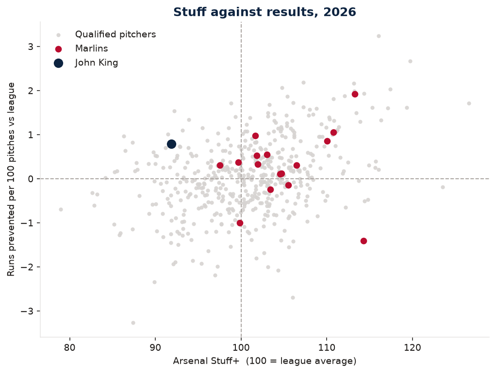
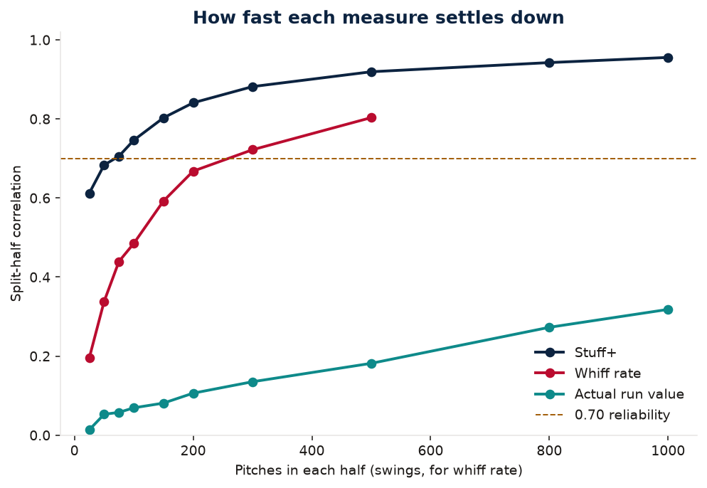
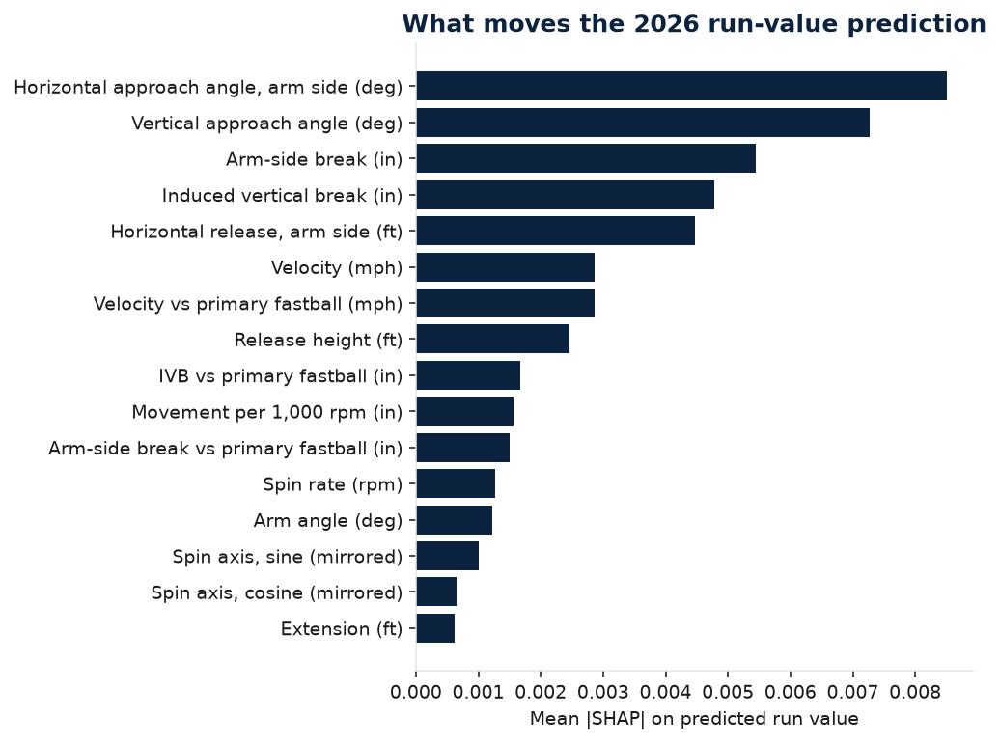
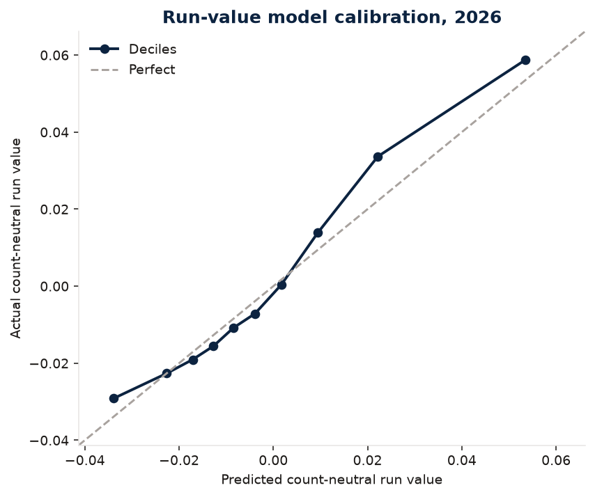
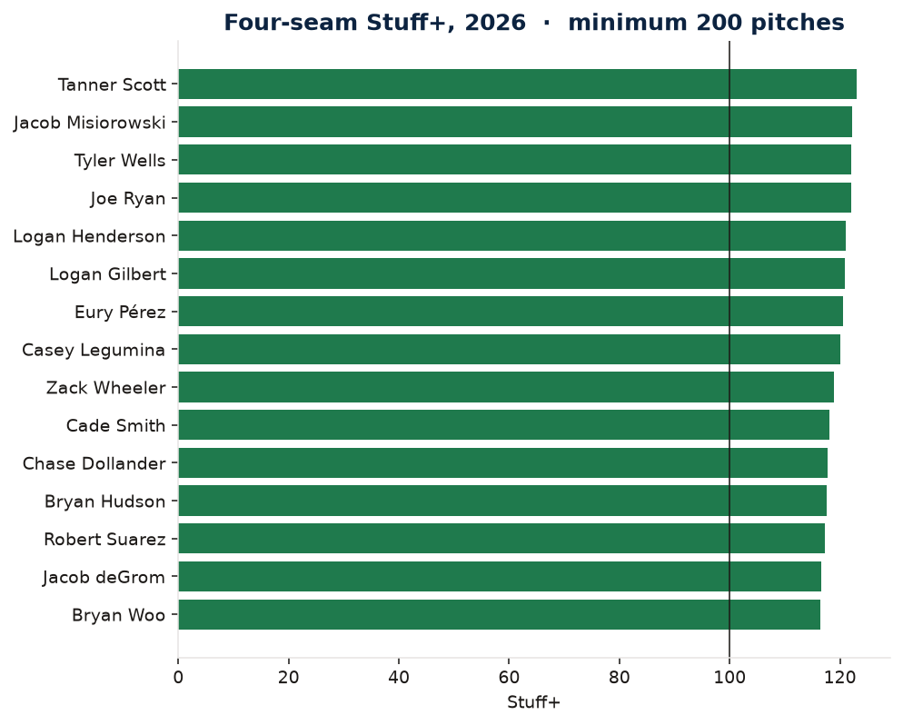
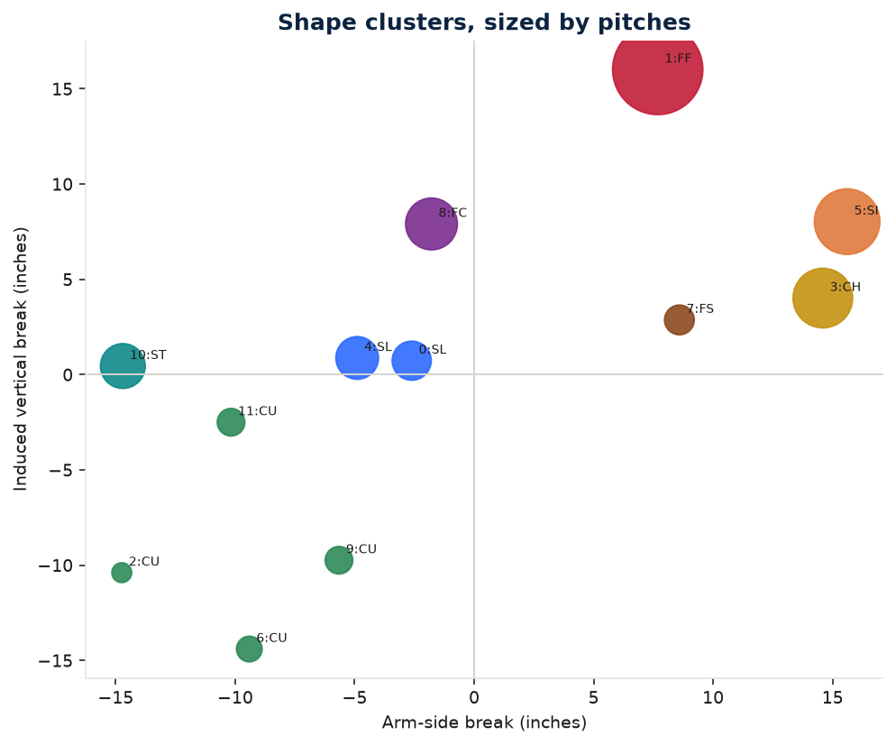
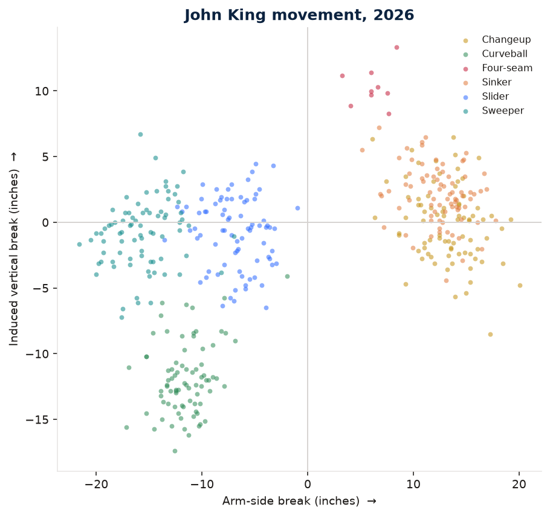

**Live app:** https://julian-mlb-stuff-plus.streamlit.app/

# Stuff+: what makes an MLB pitch effective?

A pitch-quality model for player development. The grade uses only the flight of the ball: velocity, spin, movement, release, extension, approach angles, and the gap from the pitcher's own fastball. Location, count, and the hitter are left out on purpose. Those are command and sequencing. This is the shape.

**100 is league average for that pitch type. Ten points is one standard deviation of qualified pitcher-season means. Higher is better for the pitcher.**

Built by Julian Calas as a flagship project for baseball analytics roles, including player-development work of the kind he did as an assistant coach at Barry University (live stat tracking and opposing-pitcher scouting reports).

The three questions:

1. Which physical traits make a pitch effective, with no help from the result?
2. How stable is that grade, compared with ERA, FIP, and raw whiff rate, and how many pitches does it take?
3. Where is a pitcher's stuff ahead of his results, or where is one pitch dragging the arsenal down, and what would a development staff actually try?

## Key findings

All figures below were computed in this repo from regular-season Statcast, 2024–2026. They are not copied from a published Stuff+ leaderboard.

**Shape predicts a little at the pitch, and a real amount once you average it.** On 708,677 pitches from 2026, a LightGBM model trained only on 2024–2025 has pitch-level R² = 0.016 and correlation 0.126 against count-neutral run value. A ridge regression on the same features is flat (R² ≈ 0, correlation 0.009). Averaged to pitcher and pitch type (minimum 100 pitches, 1,986 groups), the boosted model correlates 0.280 with actual run value. Pitch-level R² is supposed to be small. One pitch is the hitter, the count, and a lot of luck. The grade is a description of the ball, and it has to be judged after it is averaged.

**A separate whiff model, same features, is well calibrated.** On 337,437 swings in 2026 the holdout AUC is 0.752, Brier score 0.154, and expected calibration error is 0.004 against a 25.2% base rate. Run-value Stuff+ and the whiff grade only correlate 0.296. They are related and they are not the same grade. A pitch can prevent runs by getting called strikes and weak contact without being a whiff pitch. Sinkers are the clearest case: league whiff rate 13.7% on swings, against 33.5% for sliders.

**Approach angle and break move the grade more than raw velocity.** On a 4,000-pitch 2026 sample, mean absolute SHAP (in run-value units, batter side) is led by arm-side horizontal approach angle (0.0085), vertical approach angle (0.0073), arm-side break (0.0054), and induced vertical break (0.0048). Velocity is 0.0029. Velocity still matters, especially on four-seamers, but once break and the angle into the zone are in the model, another mile per hour is a smaller lever than the flight path.

**Stuff+ stabilizes. ERA does not.** Split-half correlation on 2026 grades:

| Sample | Stuff+ | Whiff rate | Actual run value |
| --- | ---: | ---: | ---: |
| 50 pitches | 0.68 | 0.34 | 0.05 |
| 100 pitches | 0.75 | 0.49 | 0.07 |
| 200 pitches | 0.84 | 0.67 | 0.11 |
| 500 pitches | 0.92 | 0.80 | 0.18 |

Stuff+ crosses a 0.70 correlation at 75 pitches. Whiff rate crosses it at 300 swings. Actual run value is still 0.32 at 1,000 pitches. Year over year, 2025 to 2026, Stuff+ from a model trained only on 2024 correlates 0.778 (445 pitcher-seasons, 200 pitches each year). Over the same two seasons, among pitchers with 40 innings both years (n = 256): strikeout rate 0.701, FIP 0.449, ERA 0.209.

**The development list is not "throw harder."** In 2026, among arsenals of at least 200 pitches, the rules in `src/stuffplus/recommend.py` flagged 99 pitchers whose stuff graded ahead of their results, 68 whose results were ahead of the shape, 111 usage shifts off a pitch at Stuff+ 92 or worse onto one at 103 or better, 456 shape targets taken from same-handed peers in the same velocity band, and 93 possible pitch adds drawn from what pitchers with a similar fastball cluster already throw. Every suggestion cites the comparison. None of them is a causal claim.

The worked example is **John King, LHP, Miami, 2026**: arsenal Stuff+ 92, results 1.17 runs per 100 pitches better than the shape model expected, ERA 3.99 against a FIP of 4.87. The memo is [`reports/marlins_john_king_2026.md`](reports/marlins_john_king_2026.md). A one-page opposing-pitcher card in the form Julian used at Barry is [`reports/opposing_pitcher_scouting_report.md`](reports/opposing_pitcher_scouting_report.md).







## Data

Regular-season Statcast (`game_type = R`), pulled from Baseball Savant with `pybaseball.statcast` and cached as parquet. Savant answered from this environment. No public mirror was required. Spring training and the postseason are excluded.

| Season | Pitches | Pitchers | First | Last |
| --- | ---: | ---: | --- | --- |
| 2024 | 711,899 | 855 | 2024-03-20 | 2024-09-30 |
| 2025 | 712,528 | 873 | 2025-03-18 | 2025-09-28 |
| 2026 | 716,792 | 868 | 2026-03-25 | 2026-09-27 |

The modeling frame is 2,124,073 pitches after dropping bad tracks and pitch types too rare to support a within-type average (knuckleballs, eephuses, pitchouts). Season files live in `data/raw/pitches_YYYY.parquet`. Daily chunks used to resume a pull are gitignored.

DuckDB runs the inventory, the whiff-by-pitch-type rate, and the leaderboard. Those queries are in [`sql/analysis.sql`](sql/analysis.sql). The pipeline loads them by name rather than reimplementing the aggregation in a second place.

ERA and FIP are not in the pitch table. They come from the MLB Stats API season line. FIP uses the usual formula, with the constant set so league FIP equals league ERA in that season (3.10 in 2026, league ERA 4.18). Innings like `49.2` are parsed as 49 and two-thirds, not 49.2 decimal innings.

## Method

**Target.** `delta_run_exp` is the change in batting-team run expectancy, and it is soaked in count and base-out noise. The model target replaces each pitch with the training-season average of `delta_run_exp` for its outcome bucket (whiff, called strike, foul, ball, hit by pitch, single, double, triple, home run, in-play out, field error). A 2026 whiff is worth −0.114 runs, the 2024–2025 average, whether it happened on 0-2 or 3-1. A home run is worth +1.53. The model never sees the count. Run value is from the batter's side, so negative is good for the pitcher.

**Features, all physical.** Velocity, spin rate, induced vertical break (`pfx_z` in inches), arm-side horizontal break, arm-side horizontal release, release height, extension, Statcast arm angle, vertical and horizontal approach angle at the front of the plate (y = 17/12 ft), sine and cosine of the mirrored spin axis, movement per 1,000 rpm, and velocity / IVB / arm-side gaps versus the pitcher's primary fastball. The primary fastball is the most-used of four-seam, sinker, and cutter with at least 50 pitches. Ties break to four-seam, then sinker, then cutter.

**Handedness.** Catcher-frame x is mirrored so positive means arm side for both hands. That matches Savant's `api_break_x_arm` at correlation 1.00. Spin axis for a left-hander is flipped to `(360 − axis) mod 360`. The model does not get a handedness flag, because the mirror is supposed to make "more sweep" one idea.

**Approach angle is computed, not downloaded.** Savant's `attack_angle` is the batter's swing path. It is about 56% missing and it is not the pitch. Vertical approach angle is the direction of the velocity vector when the ball reaches the front of the plate, from the published acceleration fit. Four-seamers average −4.9° (downhill). Curveballs average −10.6°.

**Arm angle.** The model uses Statcast's measured `arm_angle`. A shoulder-free proxy (release point above a 2.85 ft sidearm line) only correlates 0.72 with the measurement, with a mean absolute error of 19°, so it is a diagnostic and not a feature.

**Models.** Three baselines sit under the grade: the league mean, the pitch-type mean (the label Stuff+ is not allowed to see), and a ridge regression on the same features. The grade is LightGBM with early stopping. The published 2026 grade trains on 2024–2025 (583 trees kept). A second model trains on 2024 only (272 trees) and scores both 2025 and 2026, so year-over-year reliability is not inflated by scoring a season the model was fit on. The 2025 headline grade in the app is that frozen model. The 2026 headline grade is the 2024–2025 model, and the frozen 2026 grade is stored beside it for the comparison.

**Scale.** Within each pitch type and season, among pitcher-seasons with at least 100 of that pitch:

`Stuff+ = 100 + 10 × (league mean predicted run value − this pitch's predicted run value) / league SD`

**Clustering.** A diagonal Gaussian mixture on velocity, induced vertical break, arm-side break, and spin. k is chosen by BIC on an 60,000-pitch sample, from 8 through 12. BIC picked 12. Adjusted Rand index against the official pitch label is 0.426. The clusters partly rediscover the codebook and partly split it. Peer "add a pitch" suggestions use the fastball's cluster: what do pitchers with a similar fastball throw that this pitcher does not?

**Validation choice.** Seasons are the split, not random rows. Random rows leak the same pitcher's next start into the test set. Training earlier and testing later is the split a front office would actually have.

2026 holdout, count-neutral run value:

| Model | Pitch R² | Pitch correlation | Pitcher-pitch correlation (100+ pitches) |
| --- | ---: | ---: | ---: |
| League mean | 0.000 | — | 0.000 |
| Pitch-type mean | 0.000 | 0.004 | 0.074 |
| Ridge | 0.000 | 0.009 | 0.137 |
| LightGBM | 0.016 | 0.126 | 0.280 |

The same model against raw `delta_run_exp` (count included) has R² 0.014. Calibration is in `figures/calibration_rv.png` and `figures/calibration_whiff.png`. The run-value model is ranked correctly and a bit compressed: the best predicted bin averaged +0.054 predicted versus +0.059 actual, and the worst averaged −0.034 versus −0.029.



## What a good pitch looks like

League averages on the modeling frame, arm-side break positive for both hands:

| Pitch | Pitches | Velo | IVB (in) | Arm-side (in) | VAA |
| --- | ---: | ---: | ---: | ---: | ---: |
| Four-seam | 671,417 | 94.5 | +15.7 | +7.8 | −4.9° |
| Sinker | 340,778 | 93.7 | +7.5 | +15.1 | −6.2° |
| Cutter | 168,117 | 89.7 | +8.1 | −2.2 | −6.6° |
| Changeup | 225,500 | 85.8 | +4.6 | +14.2 | −8.0° |
| Slider | 300,592 | 86.1 | +1.7 | −4.2 | −8.3° |
| Sweeper | 165,802 | 82.5 | +1.0 | −13.7 | −8.3° |
| Curveball | 135,591 | 79.8 | −10.1 | −9.1 | −10.6° |

2026 leaderboards require 200 pitches. The top of each board is a shape, not a reputation:

- Sinker: Tyler Rogers, 138 Stuff+, 83.2 mph, −12.5 in IVB, 770 pitches. That is a different species from a 94 mph riding sinker, and the model grades the species.
- Four-seam: Tanner Scott 123 (471 pitches, 96.9 mph, 16.3 in IVB). Jacob Misiorowski is second at 122 on a full workload (1,653 pitches, 100.6 mph, 40.1% whiff).
- Slider: Graham Ashcraft 131, 90.5 mph, −8.0 in arm-side, 43.4% whiff.
- Changeup: Bryan Baker 130, 85.2 mph, +8.7 in IVB.
- Sweeper: Anthony Bender, Miami, 128, 83.5 mph, −20.2 in arm-side, 278 pitches.





## Player development

The scatter below is arsenal Stuff+ against runs prevented per 100 pitches versus the league. Up and to the right is good shape and good results. Right and down is the development list: the ball is better than the line.

John King is the memo pitcher because a Marlins development note has the most to say there. Among 2026 Marlins with at least 400 pitches he is the low end of the shape board (Stuff+ 92) and the largest gap in the other direction: results better than the model, by 1.17 runs per 100. That is the fragile-ERA case. The other case is also on the club. Janson Junk graded 106 with results 0.63 runs per 100 worse than the shape. Chris Paddack graded 100 with results 1.09 runs per 100 worse. Eury Pérez graded 106 on 2,664 pitches, with results only 0.22 runs per 100 worse than the model. Anthony Bender's sweeper is the best qualified sweeper in the majors. The app will pull any of them up.

The King recommendations that cleared the thresholds:

- Do not redesign the mix to chase a 3.99 ERA. FIP is 4.87, and the shape grade agrees with FIP.
- The changeup (83.8 mph, −0.4 in IVB, 13.5 in arm-side, Stuff+ 93) sits 4.5 inches of ride short of the median left-handed changeup in the same velocity band that grades 110 or better (9 pitcher-seasons, median Stuff+ 114). That is a bullpen target, not a promise that closing the gap adds 21 points.
- No pitch in the arsenal clears Stuff+ 103, so the usage-shift rule does not fire. There is no "throw the good one more" recommendation that meets the bar.

Full writeup, with the 2025-to-2026 shape change on the same frozen model: [`reports/marlins_john_king_2026.md`](reports/marlins_john_king_2026.md).



## How to run

Python 3.11 (`.python-version`). Community Cloud chooses the interpreter in Advanced settings and currently defaults to 3.12; it does not read `.python-version`. The runtime pins install on 3.11 and 3.12, so select 3.11 there to match this file. The Streamlit app on a fresh clone, including Community Cloud, reads `data/app` only. That bundle already has every pitcher the desk lists, precomputed grades, suggestions, reliability, and a downsampled pitch cloud for the movement and release plots. Startup does not call Baseball Savant, and the app does not load `models/stuff_models.joblib`.

```bash
python -m venv .venv
source .venv/bin/activate
pip install -r requirements.txt
streamlit run app/streamlit_app.py
```

The raw season caches (`data/raw/pitches_YYYY.parquet`), `data/processed/plot_sample.parquet`, and `models/stuff_models.joblib` stay off GitHub because of size. To rebuild them and refresh `data/app`, use Python 3.12 (the fitting stack, including `shap`, does not install on 3.11), install `requirements-dev.txt`, and rerun the pull and the pipeline. The pull resumes from `data/raw/chunks/` if a day fails.

```bash
pip install -r requirements-dev.txt
python scripts/pull_statcast.py
python scripts/run_pipeline.py
pytest

# Story notebook. Run from the repo root or from notebooks/.
jupyter nbconvert --to notebook --execute notebooks/pitch_quality_story.ipynb --inplace
```

The app defaults to the Marlins and to the memo pitcher. Pick a pitcher and read arsenal, movement, release, and the suggestion text. Leaderboard, reliability, and a short method tab are next to it.

`LEARNING_NOTES.md` is the interview version: induced vertical break, approach angles, run value, Stuff+, reliability, clustering, SHAP, and season-based validation, each with a question and a straight answer.

## Repo map

```
src/stuffplus/     physics, outcomes, fastball gaps, model, clusters,
                   reliability, recommendations, pipeline
scripts/           pull_statcast.py, run_pipeline.py, export_app_bundle.py
sql/analysis.sql   inventory, whiff rates, leaderboard
app/               Streamlit desk
notebooks/         pitch_quality_story.ipynb
tests/             physics, outcomes, reliability, recommendations, season stats
figures/           charts the README and the memo cite
reports/           Marlins memo and the opposing-pitcher card
data/app/          committed bundle the Cloud app reads
data/raw/          one parquet per season (local cache)
data/processed/    grades, metrics.json, reliability.json, suggestions
models/            fitted joblib bundle (local, not loaded by the app)
```

## Limitations

- Pitch-level R² of 0.016 is the honest ceiling of shape on a single pitch. Anyone quoting a large pitch-level R² on run value is fitting the count or the hitter.
- The run-value calibration is slightly compressed. Ranks are more trustworthy than the exact run-value gap on one pitch. The usage-shift numbers in the app are ceilings, and the text says so.
- A shape target is a comparison with pitches that already grade well, not an experiment. Closing a four-inch IVB gap does not add a promised number of Stuff+ points. The pitcher who throws that shape may also throw a different fastball, from a different slot, with a different injury history.
- The mixture model only partly matches official pitch labels (adjusted Rand 0.426). "Add the pitch his fastball-cluster peers throw" can recommend a label the pitcher already throws under a different name. The suggestion text includes the peer rate so that can be checked.
- Arm angle in the model is Statcast's measurement. The release-point proxy is not good enough to stand in for it (r = 0.72, MAE 19°).
- Team is the majority pitching team that season, inferred from home/away and inning half, because the pitch table has no pitcher-team column. A mid-season trade is labeled with the team that saw more of his pitches.
- ERA and FIP year-over-year samples are pitchers with 40 innings both years, not the same set as the Stuff+ sample. The comparison is still the right one: those are the public numbers a grade has to beat.
- 2026 whiff rate at 800 and 1,000 swings does not have enough pitchers to estimate a correlation. The curve stops at 500 swings on purpose in the chart.
- The grade does not know health, role, or the hitter. It is not a contract recommendation.

## What did not work

- Using Savant's `attack_angle` as a pitch feature. It is the swing, and it is missing on more than half the rows. Approach angle had to be integrated from `vx0, vy0, vz0, ax, ay, az`.
- Using `api_break_z_with_gravity` as induced vertical break. That column includes gravity. IVB is `pfx_z`.
- An Eckersley-line arm-angle proxy as a model feature. It was close enough to be a teaching diagnostic and not close enough to grade a pitcher.
- Ridge regression as a competitive baseline. It barely beats "predict the pitch-type mean." The interactions (a hard sinker with ride is not the same pitch as a soft sinker with drop) are why the tree model is the grade.
- Random-split validation. It was never fit. Same-pitcher leakage would have made the holdout look better than a front office could reproduce.
