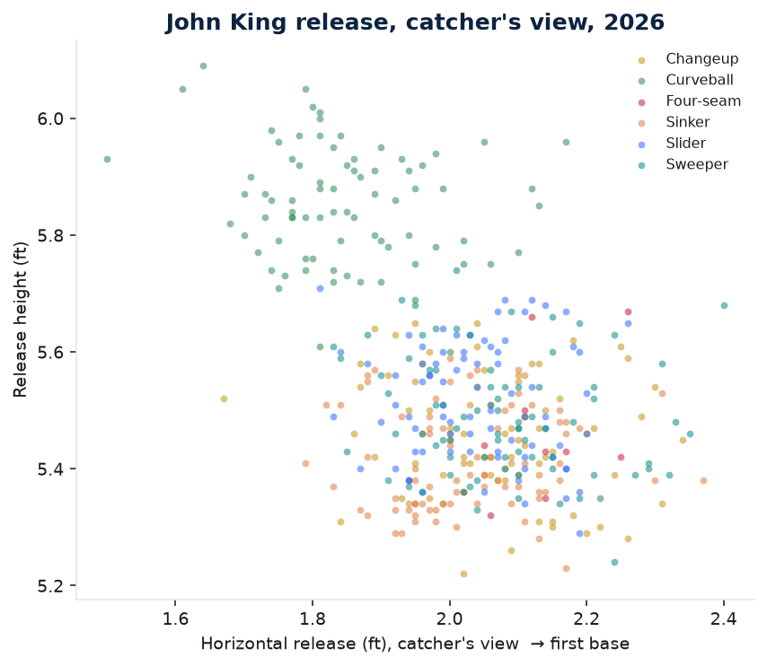
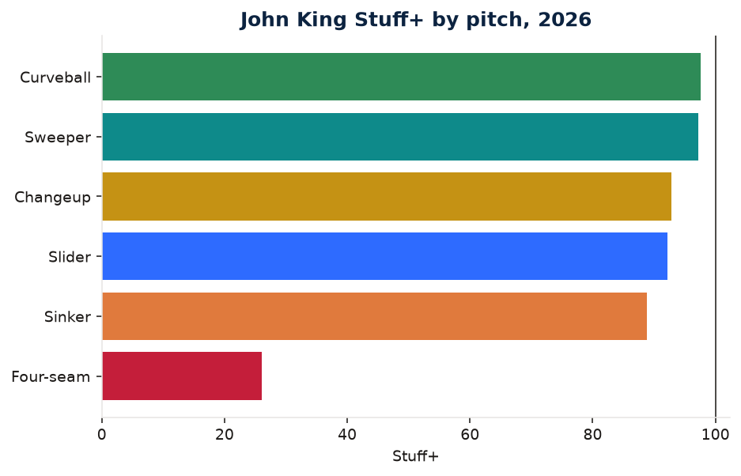

# Player development memo

**To:** Miami Marlins, Pitching / Player Development
**From:** Julian Calas
**Re:** John King, LHP — shape versus results, 2026
**Date:** 24 October 2026
**Sample:** 711 regular-season pitches, 49.2 innings, 197 batters faced. Grades are out of sample.

## Bottom line

The 3.99 ERA is ahead of the ball. Count-neutral results were **1.17 runs per 100 pitches better** than a shape-only model expected (actual −0.77 runs per 100, model +0.40). FIP is 4.87 against a league ERA of 4.18. Usage-weighted Stuff+ is **92** on the model trained on 2024–2025, and **97** on the model trained only on 2024. Both say the arsenal is below average. Do not redesign the mix to protect the ERA. The ERA is the thing that is ahead.

Two shape facts are worth a bullpen block:

1. The sinker, which was a 108 Stuff+ pitch in 2025 on the frozen model, is an 89 on this year's holdout model and a 95 on the frozen model. It lost 2.5 mph and about 4° of arm angle, and the mixture model moved it out of the sinker cluster and into the changeup cluster.
2. The changeup and the sinker are the same movement pitch, 6.6 mph apart. Same-handed changeups in this velocity band that grade 110 or better carry about 4.5 inches more ride. That is a target, not a promised gain.

No pitch in the arsenal clears Stuff+ 103, so there is no usage shift that meets the rule we use everywhere else (trim a pitch at 92 or worse, lean on one at 103 or better). The sweeper is the best new piece and it is already in the mix.

## The line, next to the grade

| | 2025 (St. Louis) | 2026 (Miami) |
| --- | ---: | ---: |
| IP | 48.1 | 49.2 |
| ERA | 4.66 | 3.99 |
| FIP | 5.00 | 4.87 |
| K% | 12.6% (28/222) | 16.8% (33/197) |
| BB | 14 | 17 |
| HR | 8 | 7 |
| Pitches | 779 | 711 |
| Stuff+, frozen 2024 model | 102 | 97 |
| Stuff+, 2024–25 model | — | 92 |
| Whiff rate | 19.8% | 21.6% |

The frozen model is the one that can compare the two years, because neither season was in its fit. The arsenal grade fell about 5 points. The sinker fell more than the arsenal. K% improved and ERA improved. FIP did not. That is the pattern this memo is about: the results moved, the shape did not come with them.

League ERA in 2026 is 4.18. FIP here uses a constant of 3.10 so that league FIP equals league ERA. King's FIP is a home-run, walk, and strikeout line, and it does not need the model to look ordinary.

## Arsenal, 2026

Stuff+ below is the 2024–2025 model, which did not see 2026. The frozen column is the 2024-only model, same scale. Run value is count-neutral and from the batter's side. Negative is good for the pitcher. Whiff rate is on swings.

| Pitch | N | Usage | Velo | IVB | Arm-side | VAA | Arm angle | Whiff | Stuff+ | Frozen | Model RV/100 | Actual RV/100 |
| --- | ---: | ---: | ---: | ---: | ---: | ---: | ---: | ---: | ---: | ---: | ---: | ---: |
| Sinker | 228 | 32% | 90.5 | +1.9 | +12.7 | −7.0° | 25° | 16.8% | 89 | 95 | +0.66 | −1.55 |
| Changeup | 142 | 20% | 83.8 | −0.4 | +13.5 | −8.7° | 23° | 34.2% | 93 | 93 | +0.49 | −2.69 |
| Slider | 136 | 19% | 82.6 | −0.7 | −6.8 | −8.6° | 27° | 20.0% | 92 | 96 | +0.18 | −0.87 |
| Sweeper | 114 | 16% | 81.5 | −1.0 | −15.5 | −8.7° | 26° | 23.1% | 97 | 99 | −0.14 | −2.13 |
| Curveball | 82 | 12% | 79.0 | −11.9 | −11.5 | −10.7° | 35° | 7.1% | 98 | 112 | +0.18 | +4.73 |
| Four-seam | 9 | 1% | 90.5 | +10.3 | +6.2 | −5.1° | 26° | — | 26 | 46 | — | — |

Ignore the four-seam. Nine pitches is not a grade. The 26 is what the model does with a handful of non-competitive four-seams, and it should not be in a meeting.

Left-handed sinkers with at least 100 pitches in 2026 (110 pitcher-seasons) sit at a median of 93.4 mph, +8.3 in IVB, +15.3 in arm-side break, arm angle 34°, Stuff+ 99, whiff rate 13%. King is 2.9 mph softer, 6.4 inches shorter on ride, 2.6 inches shorter on arm-side run, and 9° lower slot. The whiff rate (16.8%) is fine for a sinker. The grade is about the shape, and the shape is a soft, low-slot pitch that does not sink like Tyler Rogers (−12.5 in IVB, Stuff+ 138) and does not ride like a normal left-handed sinker.

The plot is the arsenal in one picture. Sinker and changeup occupy the same arm-side cloud. Sweeper is the glove-side pitch. Curveball is the one with real depth. Slider sits between the sinker and the sweeper and does not have a region of its own.

Release height is about 5.4 to 5.8 ft. The curve comes out a bit higher (5.85 ft, arm angle 35°) than the sinker (5.41 ft, arm angle 25°). That slot change is visible. It is also why the curve is a different pitch and the changeup is not.

## What changed from 2025

Same frozen model, sinker only:

| | 2025 | 2026 | Change |
| --- | ---: | ---: | --- |
| Pitches | 461 (59% of the mix) | 228 (32%) | usage cut almost in half |
| Velocity | 93.0 | 90.5 | −2.5 mph |
| IVB | +3.0 | +1.9 | −1.1 in |
| Arm-side | +14.4 | +12.7 | −1.7 in |
| Arm angle | 29° | 25° | −4° |
| VAA | −6.9° | −7.0° | flat |
| Stuff+ | 108 | 95 | −13 |

In 2025 the primary fastball landed in shape cluster 5, the sinker cluster (majority sinker, about 94.5 mph, +8 in IVB, +16 in arm-side on the league sample). In 2026 it landed in cluster 3, the changeup cluster (majority changeup, about 87 mph, +4 in IVB, +15 in arm-side). The label still says sinker. The flight says a firm changeup.

The sweeper essentially did not exist in 2025 (one pitch). It is 114 pitches and the best holdout grade in the arsenal (97, frozen 99). Adding it is already the right instinct. It is not yet a 110 pitch.

The changeup's results flipped. In 2025 it was 20% whiffs and +1.47 runs per 100 allowed. In 2026 it is 34% whiffs and −2.69 runs per 100. The shape grade barely moved (95 to 93). Thirty-four percent whiffs on 79 swings is a good changeup result. It is not, by itself, evidence that the shape improved. The model, which cannot see the result, still has it at 93.

## Recommendations

### 1. Treat the ERA as fragile

Usage-weighted Stuff+ is 92. Results were 1.17 runs per 100 pitches better than the shape model expected. On the frozen model the arsenal is 97, still short of average, and still ahead of the results by less than the holdout model thinks. Either reading says the same thing in a meeting: do not build the offseason around a 3.99, and do not scrap a pitch that is currently carrying the line just because the grade is ordinary.

Location is not the villain. Sinker location scatter is 1.04 ft against a league median of 1.04 ft for sinkers. Changeup scatter is 1.11 ft against 1.15. This is not a "he can't throw it in the zone" report. Zone rate on the sinker is 53%. Zone rate on the changeup is 30%, which is what a chase changeup is supposed to look like.

### 2. Separate the changeup from the sinker, with ride as the measured gap

The two pitches:

| | Sinker | Changeup | Gap |
| --- | ---: | ---: | ---: |
| Velocity | 90.5 | 83.8 | −6.6 mph |
| IVB | +1.9 | −0.4 | −2.3 in |
| Arm-side | +12.7 | +13.5 | +0.8 in |
| Arm angle | 25° | 23° | −2° |

A hitter who picks up the sinker picks up the changeup. The speed change is real. The movement change is not. Left-handed changeups at 80–88 mph that graded 110 or better in 2026, minimum 100 pitches, nine pitcher-seasons excluding King: median 84.8 mph, +4.1 in IVB, +14.2 in arm-side, median Stuff+ 114. The gap to that median is **+4.5 inches of ride** and +0.7 inches of arm-side run.

That peer group is not one shape. Blake Snell's changeup in the group is +8.4 in IVB. Cristopher Sánchez is −0.5 in IVB with more arm-side run (16.9 in) at 87 mph and still grades 110. The median is the bullpen target because it is the center of the pitches the model already likes, not because every good changeup looks the same. Closing the gap is not worth 21 Stuff+ points. We did not assign the ride. Pitchers who already have it may also have a different fastball behind it. The instruction to the catcher and the pitching coach is narrower than that: this changeup is a slower sinker, and the left-handed changeups that grade out have more vertical separation from a pitch that looks like this one.

Whiff grade on the changeup is 98, against a Stuff+ of 93. The whiff model, same features, thinks it misses bats at a roughly average rate for a changeup. Actual whiff rate was 34% against a predicted 29%. Results are ahead of both grades. Keep throwing it. Change the shape in the bullpen, not the usage in the game, until the shape moves.

### 3. Get the sinker back toward the 2025 version before inventing a new fastball

The 2025 sinker was 93.0 mph from a 29° slot and graded 108 on a model that had not seen 2025. This year's is 90.5 from a 25° slot and grades 95 on that same model. Approach angle did not change (−6.9° to −7.0°). The loss is velocity, slot, and the break that goes with them.

I would not ask him to become a 34° arm-angle, +8 IVB lefty sinker in one offseason. That is the league median, and it is a different pitcher. I would ask whether the 4° slot drop and the 2.5 mph were a choice. If the 2025 slot is still available, that is the first bullpen day: same grip, 2025 release height, and a check on whether IVB and arm-side run come back with it. If the slot drop is physical, the grade is telling you the pitch is now a changeup-cluster fastball, and the mix should keep leaning on the sweeper and the curve depth rather than on a sinker that no longer sinks or rides.

Usage is already down from 59% to 32%. That was the right direction. Cutting it further is not supported by a second pitch at 103 or better.

### 4. Do not bury the curve on 28 swings, and do not trust a 112 from the older model

The curve is the disagreement inside the model. The holdout grade is 98. The frozen grade is 112. Actual results were poor: 2 whiffs in 28 swings (7%), and +4.73 runs per 100 on the count-neutral scale. Against right-handed hitters it was 0 whiffs in 16 swings and +6.3 runs per 100 of raw Statcast run expectancy. Those samples are tiny. A 7% whiff rate on 28 swings is about two swings away from an ordinary curve.

The shape itself is a real curve: 79 mph, −11.9 in IVB, −11.5 in arm-side, VAA −10.7°, arm angle 35°. League curveballs average −10.1 in IVB and a −10.6° approach angle. This one has the depth. The holdout model does not think the depth is elite once velocity, slot, and the fastball gap are in the fit, which is why 98 and 112 can both be "the model." Use 98 in any comparison with other 2026 grades. Use the frozen number only against his own 2025.

Practical version: keep the curve as the depth pitch, especially as a contrast to a sinker/changeup pair that has no depth. Do not expand it against right-handed hitters on the evidence of this season. Sixteen swings is a note, not a verdict. Revisit at 150 swings.

### 5. Do not add a pitch. Tighten the two glove-side ones he already has.

The add-a-pitch rule only runs when a pitcher has three or fewer pitches at 5% usage. King throws five real pitches. The rule correctly stays quiet. The sweeper is already 16% of the mix (114 pitches, one pitch in all of 2025). It is the best holdout grade he has (97, frozen 99). The development ask is to keep that shape — 81.5 mph, −15.5 inches of sweep — and not to let it bleed into the slider, which at −6.8 inches of sweep and a 20% whiff rate is the less distinct glove-side pitch. Left-handed sweepers with at least 80 pitches had a median whiff rate of 31.5% and a median Stuff+ of 99. He is close on the grade and short on the whiffs (23%, and the whiff model predicted 29%).

## What this memo will not say

- It will not turn 1.17 runs per 100 into a projection. The reliability work says actual run value correlates 0.07 with itself at 100 pitches and 0.32 at 1,000. A 711-pitch run-value gap is a flag, not a talent estimate. Stuff+ at this sample is the stable object: split-half correlation is about 0.84 at 200 pitches and 0.92 at 500.
- It will not promise that +4.5 inches of changeup ride is worth 21 Stuff+ points. The peer median is a description of pitches the model already likes.
- It will not recommend a contract, a role, or an inning. Health, times through the order, and the hitter are not in the grade.

## Figures and where the numbers live

- Movement, release, and the grade bars: `figures/marlins_movement.png`, `figures/marlins_release.png`, `figures/marlins_stuff.png`
- Where he sits against the league: `figures/stuff_vs_results.png` (marked)
- Pitch-level table: `data/processed/marlins_arsenal.csv` and `data/processed/memo.json`
- The suggestion text in the app is the same function (`suggest_for_pitcher`) that produced the two notes above the club-context detail in this memo
